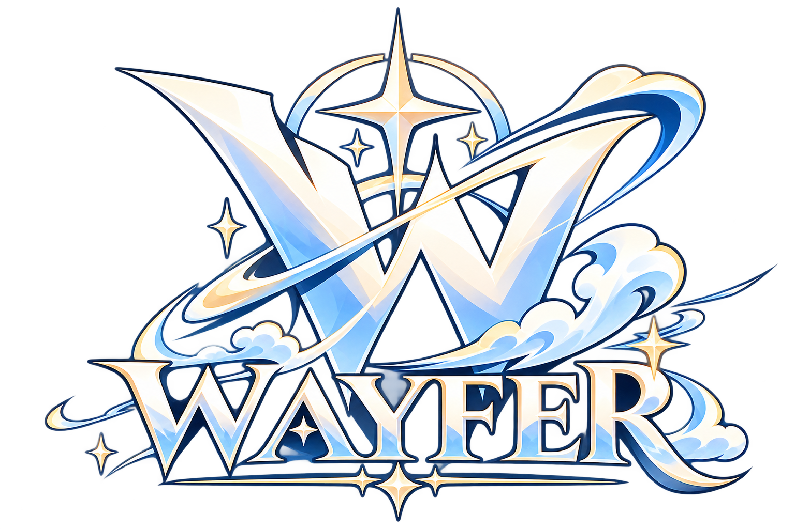

<div align="center">



# Wayfer

An AQW desktop client with a built-in bot API and an MCP control surface for AI agents.

[Usage](./USAGE.md) · [Changelog](./CHANGELOG.md) · [MCP setup](./Skua.Mcp/README.md)

</div>

## What is Wayfer?

Wayfer is a desktop client for **AdventureQuest Worlds (AQW)**. It embeds the
real game through Ruffle, runs the Skua bot engine in .NET, and exposes the
character to an AI agent through MCP.

Wayfer is built on [Skua](https://github.com/auqw/Skua).

## Features

- **Play AQW on desktop** — embedded Ruffle game host with login, server
  selection, logout, and character loading.
- **Bot tools** — script loader, plugins, options, packet tools, logs, jump,
  auto, fast travel, drops, and the usual Skua APIs through `IScriptInterface`.
- **C# scripting** — scripts live in
  `~/Library/Application Support/Skua/Scripts` and can be written, run, paused,
  resumed, or stopped from the app.
- **MCP for AI agents** — 42 tools for login, server switching, logout, map
  contents, movement, map/room joining, combat, quests, shops, inventory, and
  script lifecycle.
- **Map awareness** — reads the live map SWF and tells the agent which NPCs are
  in the room, which cell they stand in, the quests they offer, and the shops
  they open.
- **Lightweight rendering** — Ruffle `webgl`, AQW smooth background, and
  `MEDIUM` quality by default (roughly 53–60 FPS at 960×600 on Apple Silicon).

## Platform

| Platform | Status |
|---|---|
| macOS | Full game host + UI + MCP (validated) |
| Linux | MCP agent and Avalonia UI; native game host needs a WebKitGTK/WPE bridge and is not yet validated |

For a Linux AI agent, run the game host on a Mac and connect over LAN or an SSH
tunnel.

## Requirements

- .NET SDK 10 (`~/.dotnet`)
- Java 17+ (`java` on `PATH`, or `JAVA_HOME`) for map NPC/quest/shop discovery
- macOS for the game host
- AQW assets shipped in `Skua.App.Avalonia/` (`skua.swf`, `wwwroot/ruffle`)

## Quick start

```bash
export DOTNET_ROOT="$HOME/.dotnet"
export PATH="$HOME/.dotnet:$PATH"

cd Skua.App.Avalonia
dotnet build
dotnet run
```

The app opens at the login screen. Use the **+** button in the menu bar to open
the bot tools.

### Server-only mode

For browser or automation tests:

```bash
dotnet run -- --server-only
```

The game page is served at `http://127.0.0.1:8765/`.

## MCP for AI agents

Wayfer exposes a local HTTP control API, and `Skua.Mcp` is the stdio MCP server
that AI clients connect to:

```
AI agent (Linux/macOS)
  └─ Skua.Mcp (stdio)
       └─ HTTP + Bearer token
            └─ Wayfer control API (:8766)
                 └─ IScriptInterface → Ruffle/AQW
```

The tools cover:

- login / select server / logout / relogin
- status, map, map NPCs, players, monsters, servers
- join room, jump, walk, goto player
- attack, kill, cancel attack, leave combat, rest
- quest load / accept / complete / abandon
- shop load / inspect / buy
- script write / run / pause / resume / stop / logs

See [`Skua.Mcp/README.md`](./Skua.Mcp/README.md) for the client config, full tool
table, security notes, and examples.

### Control API

The API listens on `http://127.0.0.1:8766` by default.

| Variable | Default | Meaning |
|---|---|---|
| `WAYFER_CONTROL_ENABLED` | `1` | Set `0` to disable the API |
| `WAYFER_CONTROL_BIND` | `127.0.0.1` | Bind address; `0.0.0.0` for LAN |
| `WAYFER_CONTROL_PORT` | `8766` | HTTP port |
| `WAYFER_CONTROL_TOKEN` | empty | Required for non-loopback binds |

Legacy `SKUA_CONTROL_*` variables and `X-Skua-Token` are still accepted.

Do not expose port `8766` directly to the internet. Use loopback, a VPN, or an
SSH tunnel. `wayfer_login` sends the AQW password over this channel, so treat
the token like a remote-shell token.

## Rendering

Wayfer forces AQW's smooth background and `MEDIUM` stage quality to avoid the
`BitmapData.draw` path that Ruffle's vanilla `webgl` renderer does not support.

For debugging, append query parameters to the game URL:

- `?renderer=webgl|wgpu-webgl|webgpu|canvas` (default `webgl`)
- `?smooth=0` (keep the cached map bitmap; requires a `BitmapData.draw`-capable renderer)
- `?lowq=0` (keep quality `HIGH`)
- `?verbose` (Ruffle info logs and a 20k-line page log)

The same options can be set without editing the URL:

| Variable | Effect |
|---|---|
| `WAYFER_RENDERER` | `webgl` (default), `wgpu-webgl`, `webgpu`, or `canvas` |
| `WAYFER_SMOOTH=0` | Disable forced smooth background |
| `WAYFER_LOWQ=0` | Keep `HIGH` quality |
| `WAYFER_VERBOSE=1` | Ruffle verbose logs |

If a future game update requires `BitmapData.draw`, try `?renderer=wgpu-webgl`.

## Architecture

- `LocalGameServer` — proxies `/ga/*` to game.aq.com, rewrites the server list to
  the local WebSocket relay, and unpacks compressed `Z` packets.
- `MapInfoService` — downloads the active map SWF, decompiles it with FFDec, and
  extracts NPC cells, quest ids, shop ids, and map exits (cached per map file).
- `WebFlashUtil` — bridges ExternalInterface calls between the page and
  `/skua.swf`.
- `Skua.Avalonia` — cross-platform dialogs, windows, clipboard, hotkeys, theme,
  and sound services.
- `Skua.Core` — scripting API, packet handling, bot services, and ViewModels.
- `Skua.Mcp` — cross-platform stdio MCP server.

## Troubleshooting

- Run `dotnet build` after editing `wwwroot` or assets; `--no-build` does not
  copy changed files.
- Make sure no other process is using port `8765`.
- If the game is stuck, use the reload-map tool or restart the app.
- Logs: the app writes to the console; the MCP control API is separate from the
  game server.

## Credits

Wayfer is based on [Skua](https://github.com/auqw/Skua), the successor to
[RBot](https://github.com/rodit/RBot). Thanks to the Skua authors, contributors,
and scripters for the original engine and tooling.

Wayfer is an independent fork and is not affiliated with the Skua team.
